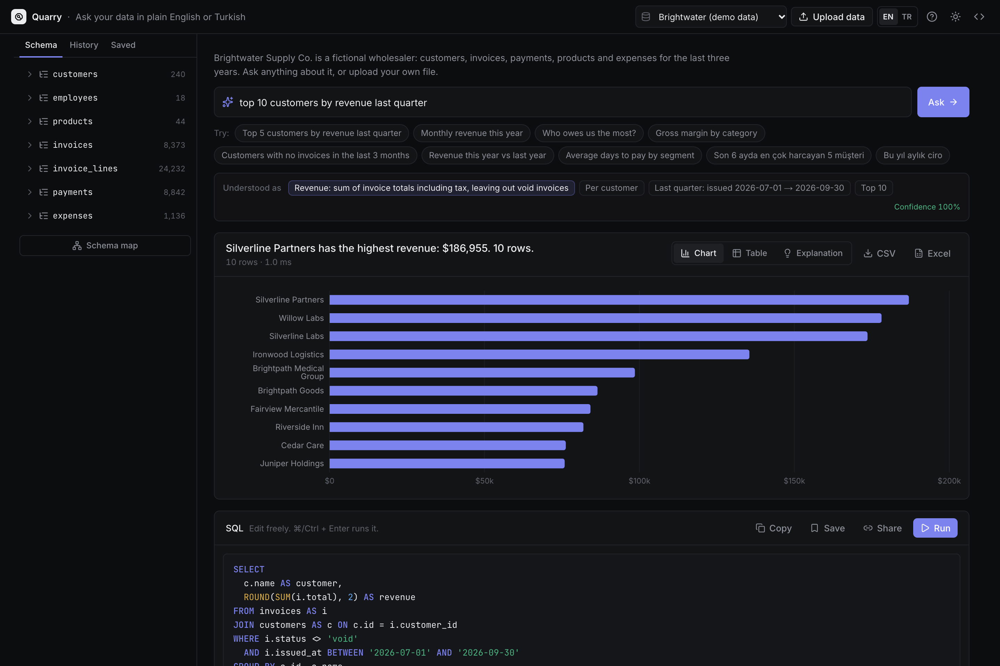
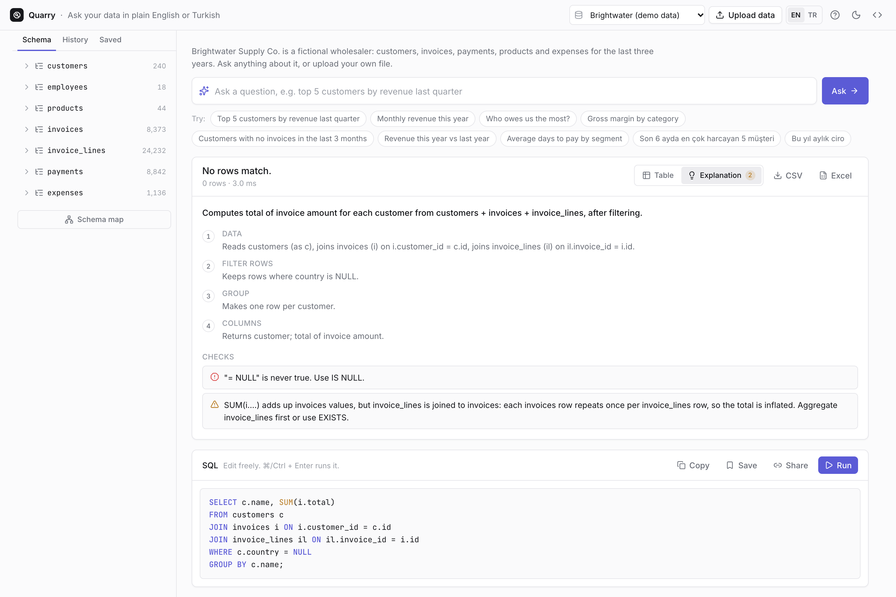
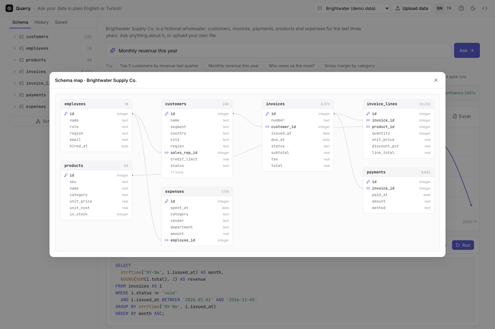

# Quarry

**Ask a database questions in plain English or Turkish and get SQL you can read, run, chart and export.** The text-to-SQL engine is rule-based and runs in your browser next to SQLite (WebAssembly). There is no AI service, no API key and no server.

**[Live demo](https://ozenyunus35.github.io/sql-copilot/)** · Demo data is synthetic: Brightwater Supply Co., a fictional wholesaler, with three years of customers, invoices, payments, products and expenses.


## What it does

- **Questions to SQL, in two languages.** For example "top 5 customers by revenue last quarter" or "son 3 ayda hiç faturası olmayan müşteriler". It reads:
  - Turkish suffixes (müşterilerin, Almanya'daki, 2024'ten beri);
  - typos (revnue, quater);
  - numbers written as 10k, 5.000 or 5 bin;
  - dates such as "last 6 months", "geçen çeyrek", "Q3 2025", "the third quarter of 2025" and "between March and June".
- **Shows how it read the question.** Each piece of the reading appears as a chip: the measure and its exact definition, groups, filters, the date range with real dates, and top N. Words it ignored are listed. When a phrase has another reading, the other reading is offered with one click.
- **Business measures, not just columns.** Revenue leaves out void invoices. Outstanding is invoice totals minus what has been paid. The engine also knows days to pay, gross profit, margin and units sold. Grouping by product switches revenue to the invoice-line level, so totals are never double counted.
- **Answers in a sentence, a chart and a table.**
  - The sentence reads like "Willow Labs has the highest revenue: $370,959" or "Latest: 2026-11 so far".
  - Time series become lines and categories become bars.
  - Tables sort by column; results export to CSV or Excel.
- **Explains any SQL.** It explains generated SQL and SQL you type, step by step, in English or Turkish, and flags mistakes:
  - `= NULL` and WHERE on an aggregate;
  - columns that are neither grouped nor aggregated;
  - SUMs inflated by a join to a child table;
  - AND/OR without parentheses, dates not in ISO form, NOT IN with NULLs;
  - cartesian joins, integer division, DELETE or UPDATE without WHERE.

  A misspelled column gets "Did you mean customer_id (in invoices)?".
- **Your own data.**
  - Supported files: CSV, TSV, Excel (.xlsx, every sheet), JSON and SQLite.
  - Several CSVs become related tables; `orders.customer_id` links to `customers` when the values line up.
  - Types and roles are inferred: money, quantity, dates (day-first or month-first, decided from the values), categories and names.
  - Turkish and European number formats, Windows-1254 files, title rows above the header and (accounting) negatives are handled.
  - PDFs, images, Word files, old .xls files and other unsupported files are rejected with a clear reason.
  - Uploads stay in IndexedDB, in this browser.
- **Around it:** a schema browser with column profiles, a schema map, history, saved queries, share links, light and dark themes, an English and Turkish interface, and a phone layout.

| Ranking, dark theme | Turkish question | Checks on hand-written SQL |
| --- | --- | --- |
|  |  |  |

| Schema map | Phone |
| --- | --- |
|  |  |

## How accurate it is

Answers are checked by running both the engine's SQL and a hand-written reference query against the database, then comparing the results.

| Set | Questions | First run | After fixes |
| --- | ---: | ---: | ---: |
| Holdout 2 (written after tuning, mixed styles, never seen) | 56 | **82%** (9 wrong, 1 no answer) | 100% (now part of tuning) |
| Holdout 1 | 64 | 77% | 100% (now part of tuning) |
| Random questions, unseen seeds 404 / 505 / 606 | 3 × 300 | **98–99%** (1.3–2.3% wrong) | n/a |

How the numbers were made:
- The **82% first run on holdout 2** is the honest number for new phrasings. Both holdouts were retired into the tuning set after their first run.
- The random generator mixes measures, groups, filters, dates and top N in both languages, with filler words and typos. Its vocabulary overlaps the engine's dictionary, so its numbers are optimistic.
- The full log is in [docs/accuracy-log.txt](docs/accuracy-log.txt).

**Known limits:**
- It answers one question shape at a time: a measure, optional groups, filters, a date range, top N, a share of total, change from the previous period, or two periods side by side.
- It does not handle nested logic, such as "customers whose revenue grew more than the average", or medians and percentiles.
- On uploads it only knows the words in the column names, plus a dictionary of common business words in English and Turkish.
- When it can't map a question, it says so instead of guessing.

## How it works

1. **Words.** Text is folded (case, Turkish letters, accents) and tokenized.
   - Phrases are matched against a dictionary built from the semantic model: tables, columns, values and measures in English and Turkish.
   - Matching allows English plurals, chains of Turkish suffixes and a typo or two on longer words.
2. **Meaning.** Ambiguous words are settled by the rest of the question.
   - "spend" is revenue when customers are mentioned and expenses otherwise.
   - "sales" is the department only next to "department".
   - "unpaid invoices" is a status filter, not the outstanding measure.
3. **Plan.** From the pieces it decides:
   - the measure, the groups (entity, column, time grain or periods side by side) and the filters (values, comparisons, dates);
   - HAVING conditions, order and limit;
   - special shapes: "with no …" (NOT EXISTS), "how many customers spent over 100k" (count of groups) and "average revenue per customer" (average of groups).
4. **SQL.** Joins follow the relations from the measure's table.
   - A filter on a child table becomes `EXISTS`.
   - A group below the measure's grain switches to a finer measure, so nothing double counts.
   - The SQL is formatted for people to read.

Code: `src/lib/nl` (parser), `src/lib/sql` (explainer and checks), `src/lib/import` (uploads), `src/lib/model.ts` (semantic model).

## Run it

```bash
npm ci
npm run dev          # http://localhost:3000
npm test             # unit tests, including the accuracy sets
npm run build && npm run test:e2e   # Playwright: desktop Chrome and Safari, iPhone, Android
```

Built with Next.js 16 (static export), React 19, Tailwind CSS 4, sql.js, Recharts, ExcelJS, Vitest and Playwright. GitHub Actions runs lint, types, unit tests, build and end-to-end tests, then deploys to GitHub Pages.

MIT License · Yunus Ozen
