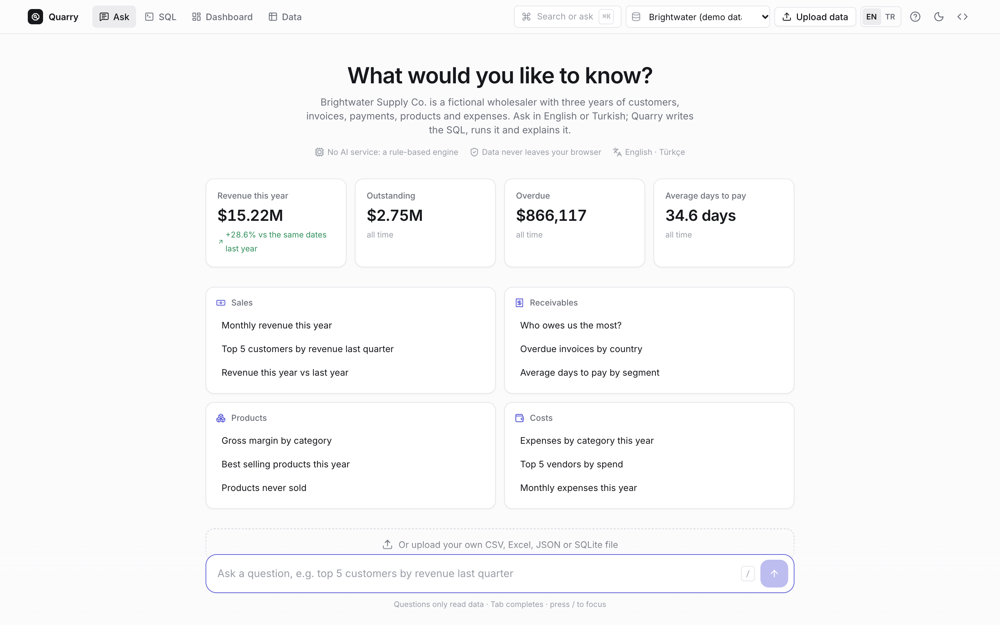
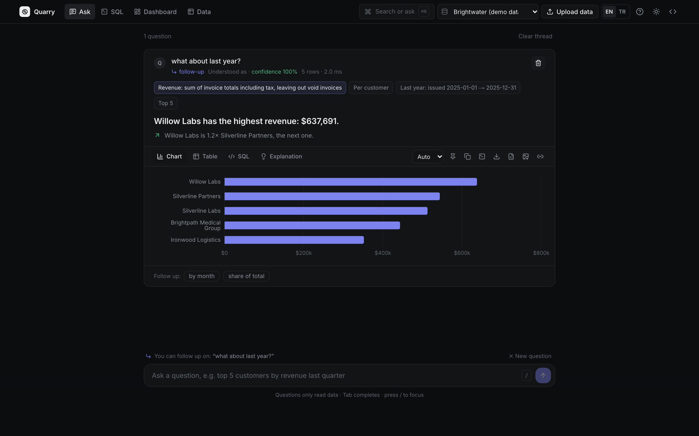
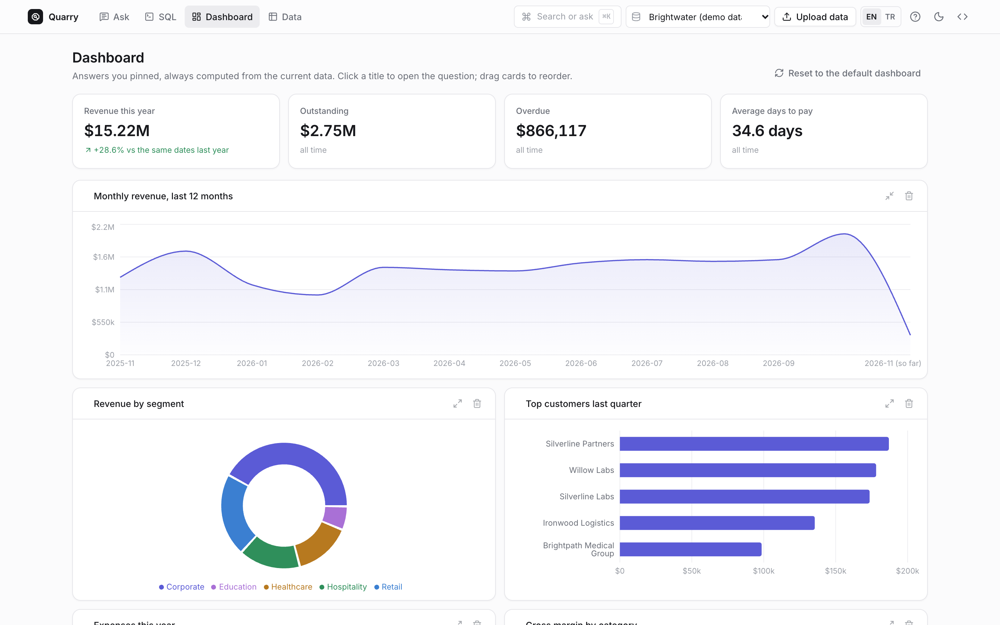
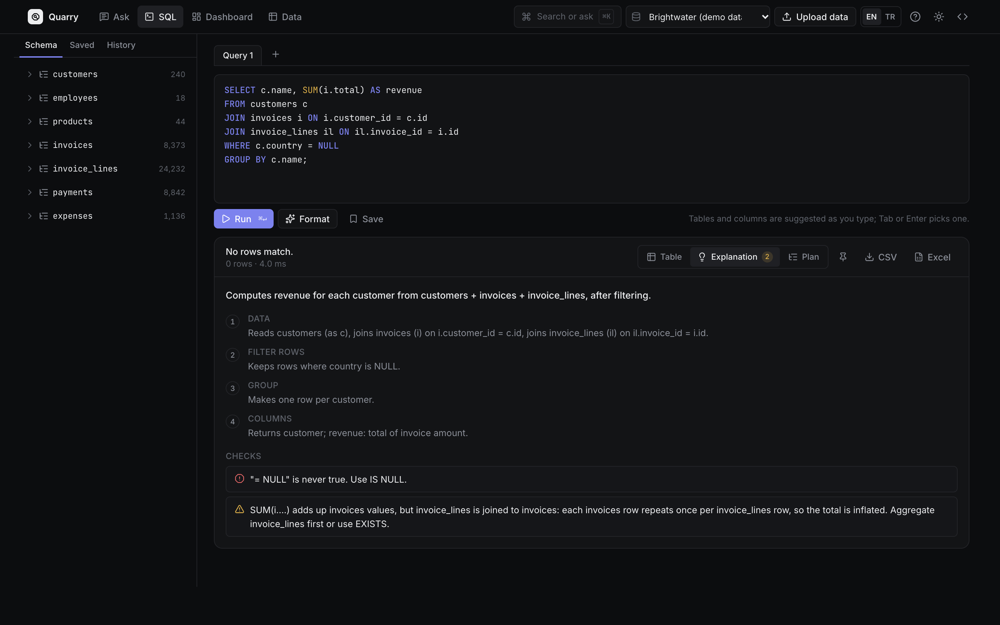
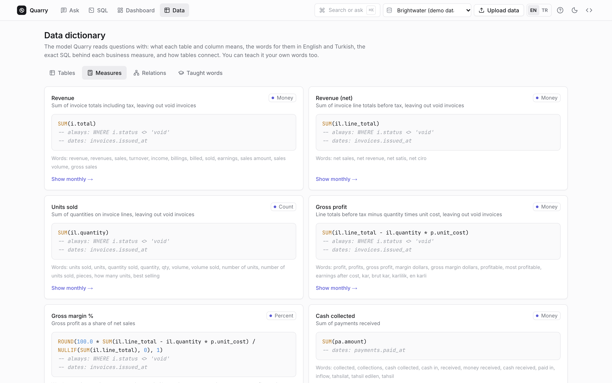
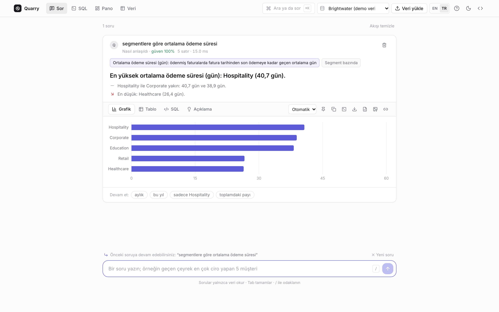
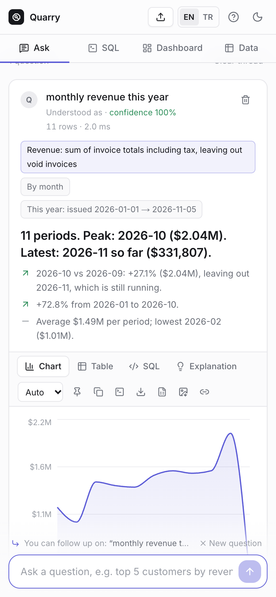

# Quarry

**Ask a database questions in plain English or Turkish and get SQL you can read, run, chart and export.** The text-to-SQL engine is rule-based and runs in your browser next to SQLite (WebAssembly). There is no AI service, no API key and no server.

**[Live demo](https://ozenyunus35.github.io/sql-copilot/)** · Demo data is synthetic: Brightwater Supply Co., a fictional wholesaler, with three years of customers, invoices, payments, products and expenses.



## What it does

**Ask**
- **Questions to SQL, in two languages.** Ask "top 5 customers by revenue last quarter" or "son 3 ayda hiç faturası olmayan müşteriler". It reads:
  - Turkish suffixes, such as müşterilerin, Almanya'daki and 2024'ten beri;
  - typos, such as revnue and quater;
  - numbers written as 10k, 5.000 or 5 bin;
  - dates such as last 6 months, geçen çeyrek, the third quarter of 2025 and between March and June.
- **Follow-up questions.** After an answer you can say "what about last year?", "only Germany", "now by month", "units instead" or "peki Fransa?". Quarry keeps everything the new words don't change, such as a top 5 or a date range, and marks the card as a follow-up.
- **Answer cards.** Each card shows:
  - a one-sentence answer, like "Willow Labs has the highest revenue: $637,691";
  - computed observations: the share of the total, the gap to the next one, the change from the period before and the trend over the series;
  - a chart you can switch between bars, rows, line, area and donut, plus the table, the SQL and an explanation;
  - one-click follow-up suggestions.
- **How the question was read.** The measure appears with its exact definition, together with the groups, the filters, the date range with real dates and top N. Ignored words are listed, and when a word has another meaning, that reading is one click away.
- **Autocomplete.** The question box suggests measures, tables, columns, values and dates in both languages as you type.

**SQL**
- **An editor.**
  - Query tabs, syntax highlighting and completion that knows aliases (`i.` lists the invoice columns).
  - A formatter, saved queries and history.
  - The query plan (EXPLAIN QUERY PLAN), with full table scans marked.
- **Explanations and checks for any SQL, in English or Turkish.** It flags:
  - `= NULL` and WHERE on an aggregate;
  - columns that are neither grouped nor aggregated;
  - SUMs inflated by a join to a child table;
  - AND/OR without parentheses, dates not in ISO form, NOT IN with NULLs;
  - cartesian joins, integer division, and DELETE or UPDATE without WHERE (these ask before running).

  A misspelled column gets "Did you mean customer_id (in invoices)?".

**Dashboard**
- **A finance overview to start with:**
  - revenue this year compared with the same dates last year;
  - outstanding and overdue balances, and average days to pay;
  - monthly revenue, revenue by segment, top customers, expenses and margin.
- Pin any answer to the dashboard. Pinned cards are computed from the current data and can be reordered and resized.

**Data**
- **A data dictionary.** For every table and column it shows the meaning, its role (key, link, money, date, category…), the words for it in both languages and the values it holds. Every business measure is listed with its exact SQL. A relations map shows how the tables connect.
- **Teach it your words.** For example, tell it that "enterprise" means the Corporate segment and that "top line" means revenue. Taught words are kept per dataset, in this browser.
- **Your own data.**
  - Formats: CSV, TSV, Excel (every sheet), JSON and SQLite.
  - Several CSVs become related tables.
  - Types and roles are inferred, and dates are read day-first or month-first depending on the values.
  - Turkish and European numbers, Windows-1254 files, title rows above the header and (accounting) negatives are handled.
  - PDFs, images, Word files and old .xls files are rejected with a clear reason.

**Everywhere:**
- A ⌘K command palette and keyboard shortcuts.
- An English and Turkish interface.
- Light and dark themes and a phone layout.
- Share links and CSV, Excel and PNG exports.
- Nothing leaves the browser.

| Follow-up question | Dashboard |
| --- | --- |
|  |  |

| SQL editor with checks | Data dictionary | Turkish |
| --- | --- | --- |
|  |  |  |



## How accurate it is

Answers are checked by running both the engine's SQL and a hand-written reference query against the database, then comparing the results.

| Set | Questions | First run | After fixes |
| --- | ---: | ---: | ---: |
| Holdout 2 (written after tuning, mixed styles, never seen) | 56 | **82%** (9 wrong, 1 no answer) | 100% (now part of tuning) |
| Holdout 1 | 64 | 77% | 100% (now part of tuning) |
| Random questions, unseen seeds 404 / 505 / 606 | 3 × 300 | **98–99%** (1.3–2.3% wrong) | n/a |

How the numbers were made:
- The **82% first run on holdout 2** is the honest number for new phrasings. Both holdouts were retired into the tuning set after their first run.
- The random generator mixes measures, groups, filters, dates and top N in both languages, with filler words and typos. Its vocabulary overlaps the engine's dictionary, so its numbers are optimistic.
- The full log is in [docs/accuracy-log.txt](docs/accuracy-log.txt).

**Known limits:**
- It answers one question shape at a time: a measure, optional groups, filters, a date range, top N, a share of total, change from the previous period, or two periods side by side.
- It does not handle nested logic, such as "customers whose revenue grew more than the average", or medians and percentiles.
- On uploads it only knows the words in the column names, plus a dictionary of common business words in English and Turkish.
- When it can't map a question, it says so instead of guessing.

## How it works

1. **Words.** Text is folded (case, Turkish letters, accents) and tokenized.
   - Phrases are matched against a dictionary built from the semantic model: tables, columns, values and measures in English and Turkish.
   - Matching allows English plurals, chains of Turkish suffixes and a typo or two on longer words.
2. **Meaning.** Ambiguous words are settled by the rest of the question.
   - "spend" is revenue when customers are mentioned and expenses otherwise.
   - "sales" is the department only next to "department".
   - "unpaid invoices" is a status filter, not the outstanding measure.
3. **Plan.** From the pieces it decides:
   - the measure, the groups (entity, column, time grain or periods side by side) and the filters (values, comparisons, dates);
   - HAVING conditions, order and limit;
   - special shapes: "with no …" (NOT EXISTS), "how many customers spent over 100k" (count of groups) and "average revenue per customer" (average of groups).
4. **SQL.** Joins follow the relations from the measure's table.
   - A filter on a child table becomes `EXISTS`.
   - A group below the measure's grain switches to a finer measure, so nothing double counts.
   - The SQL is formatted for people to read.

Code: `src/lib/nl` (parser), `src/lib/sql` (explainer, checks, formatter), `src/lib/import` (uploads), `src/lib/model.ts` (semantic model), `src/lib/insights.ts` (observations), `src/lib/complete.ts` (autocomplete).

## Run it

```bash
npm ci
npm run dev          # http://localhost:3000
npm test             # unit tests, including the accuracy sets
npm run build && npm run test:e2e   # Playwright: desktop Chrome and Safari, iPhone, Android
```

Built with Next.js 16 (static export), React 19, Tailwind CSS 4, sql.js, Recharts, ExcelJS, Vitest and Playwright. GitHub Actions runs lint, types, unit tests, build and end-to-end tests, then deploys to GitHub Pages.

MIT License · Yunus Ozen
